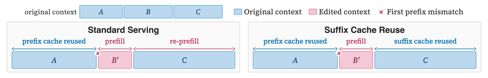
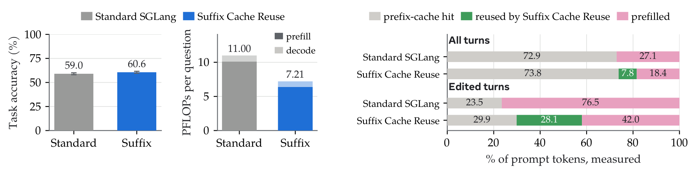
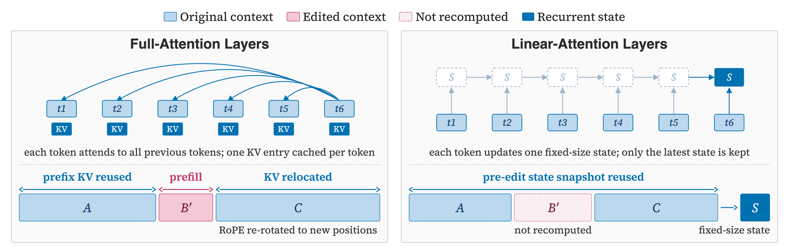
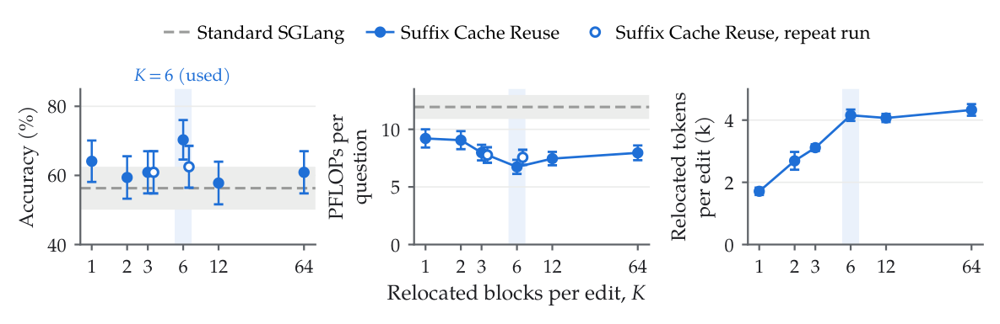
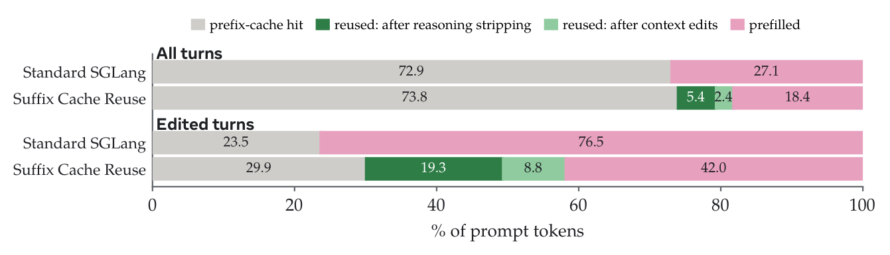
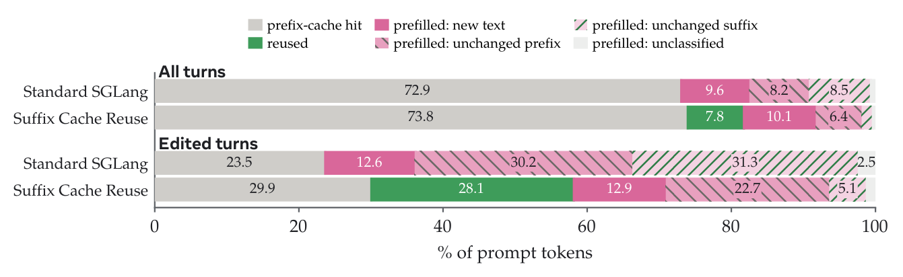

# Suffix Cache Reuse

**Efficient CLM serving: reuse the KV cache of text that survives a context edit, for SGLang and vLLM.**

A CLM edits its own context, so the prompt changes in the middle rather than only at the
end. Standard prefix-cache reuse must then re-prefill every token after the first mismatch.
Suffix Cache Reuse (SCR) removes most of this re-prefilling. When a span B is replaced by B′
after an edit, SCR reuses the cached states of all surviving tokens, including C, and only
reprefills the newly inserted or appended tokens B′. Surviving suffix tokens C thus retain
stale cache states that encode the previous prefix, which can even be beneficial in some
cases, as it retains richer information from the past. By contrast, standard prefix-cache
reuse must re-prefill all tokens after the first mismatch (B′ and C).

<em>Standard serving reuses only prefix-matched cache, while SCR reuses cached states for all surviving tokens, reducing re-prefilling.</em>

## Results

SCR effectively reduces cache re-prefilling, matching the standard SGLang serving with
65.5% of its empirical prefix-reuse FLOPs on BrowseComp-Plus (BCP), averaged over three seeds
(accuracy 60.6% with SCR and 59.0% with standard serving). SCR is not limited to
CLMs: serving engines commonly strip prior reasoning tokens from chat histories, causing
subsequent preserved tokens to be re-prefilled, and SCR also reduces this re-prefilling cost.

<em>SCR and standard SGLang serving on BCP with Qwen3.6-27B, pooled over three seeds. Left: task accuracy and
prefix-reuse FLOPs per question. Right: server-side compute decomposition, showing the fraction
of prompt tokens by compute type across all turns and turns following context edits.</em>

SCR for vLLM 0.19.1 shows the same pattern on all 830 BCP questions with Qwen3.6-27B over three
seeds: it lowers prefix-reuse FLOPs per question by 24.7% and the time per question by 12.5%,
with accuracy on par with standard vLLM serving (58.88% with SCR and 58.80% with standard
serving). See [`vllm/`](vllm/README.md#performance) for these results and serving-speed
benchmarks.

## How it works

**Background: the radix tree in SGLang.** SGLang keeps the KV cache of served requests in a
radix tree over token sequences. A new request walks the tree to its longest matching prefix,
reuses the KV entries along that path, and prefills only the remaining tokens, so reuse stops
at the first mismatched token. After an in-the-middle edit, every token after the edit is
re-prefilled, including text that survived unchanged. SCR keeps this tree as is and extends
reuse to the surviving tokens beyond the matched prefix.

<em>Suffix Cache Reuse for full-attention layers (left) and linear-attention layers (right).</em>

**Full-attention layers.** Consider a context `[A B C]` in which an edit replaces B with B′.
Standard serving matches only A and re-prefills B′ and C. When a new prompt arrives, SCR
diffs it against the session's previous prompt to find the spans that survived the edit, and
relocates up to K of them, largest first (K=6 by default). For each relocated span such as C,
it reuses the cached keys and values, re-rotates the keys' rotary position encodings to their
new positions, and splices them in after B′. Only B′ and newly appended tokens are prefilled.
Relocated entries live in session-private cache slots, so the shared radix tree never holds a
moved entry; if these slots cannot be allocated, the server falls back to standard
re-prefilling.

**Linear-attention layers.** In hybrid models such as Qwen3.6-27B (48 of 64 layers use
linear attention), linear-attention layers maintain a fixed-size recurrent state rather than
per-token caches, so there are no token-level entries to relocate. For these layers, SCR
snapshots the recurrent state before the edit and continues from that snapshot, while the
edit is reflected in the 16 full-attention layers that retain token-level context. B′ is
still recomputed in the full-attention layers and can influence later linear-attention layers
through their inputs.

**Multiple surviving spans.** A single edit may leave multiple surviving spans after the edit
point. SCR caps the number of relocated spans per edit at K, reusing the K longest spans and
re-prefilling the rest. This bounds the amount of approximation introduced at once. On 64 BCP
questions with Qwen3.6-27B, performance is robust across K, while cache-reuse gains largely
saturate by K=6.

<em>Relocated spans per edit, K, on 64 BCP questions with Qwen3.6-27B. Left: task accuracy.
Middle: prefix-reuse PFLOPs per question. Right: relocated tokens per edited request. Dashed
lines show standard SGLang; the shaded column marks K=6.</em>

**Bonus: stripped reasoning tokens.** Chat templates for reasoning models, including Qwen3.6,
often remove the reasoning block from earlier assistant turns once the next user message
arrives. Standard serving then re-prefills all preserved text after the first removed block,
even when the agent never edits its own context. SCR treats reasoning stripping as another
context edit and reuses the cached states of the preserved text. On BCP, of the 7.8% of all
prompt tokens reused by SCR beyond prefix-cache hits, 5.4 points come from reasoning
stripping and 2.4 from other context edits.

<em>SCR reuses cached states after model-driven context edits and after reasoning tokens are
stripped from prior turns. Qwen3.6-27B on 830 BCP questions, K=6.</em>

**Future improvement space.** SCR removes most re-prefilling of unchanged suffix tokens
after an edit. Much of the remaining redundant prefill instead comes from unchanged prefixes
that standard prefix caching should ideally reuse. Linear-attention layers maintain recurrent
states, which SGLang stores only at cached request boundaries; when a later prompt diverges
inside a cached span, no recurrent state is available near the branch point, so cache
matching can fall back to a much shorter prefix. This affects both standard prefix caching
and the efficiency attainable with SCR. Storing recurrent states at finer-grained locations,
such as message boundaries, is therefore a promising direction for improving both.

<em>Remaining re-prefill under SCR on BCP. SCR removes most re-prefilling of unchanged suffix
tokens, while unchanged-prefix prefill remains due to the current hybrid-model caching
behavior in SGLang. Same runs as the figure above.</em>

## Implementations

| | |
|---|---|
| [`sglang/`](sglang/) | SCR for SGLang 0.5.16: install, run, settings, log analysis, and tests. The figures above were measured with this version. |
| [`vllm/`](vllm/) | SCR for vLLM 0.19.1 (v1 engine), built on vLLM's scheduler and KV-connector extension points: install, run, settings, tests, and results. [DESIGN.md](vllm/DESIGN.md) describes the integration. |

Both implementations follow the same algorithm, and settings that carry over have the same names and defaults (K=6 by default).

## License

See the repository [LICENSE](../LICENSE).
